# The CPU: A Very Tall Pile of Simple

  

This guide starts with a switch and a light bulb, and builds up part by part towards a working simple 8-bit CPU.

Relays, logic gates, adders, memory, a bus, an ALU, a control unit, and finally a simple program running on the CPU.

## Read it

- **Web:** https://www.bytecolony.computer/writing/the-cpu/
- **PDF (print):** https://www.bytecolony.computer/assets/the-cpu-explainer-print.pdf
- **Everything else** (dark and light PDFs, EPUBs): [the formats page](https://www.bytecolony.computer/projects/the-cpu-explainer/#formats)

## A few of the diagrams

  
  
  

## What's inside

**Part 1: Foundations.** Basic circuits and switches, then relays, all the way up to logic gates. Part 1 also covers binary, and builds an 8-bit adder circuit.

**Part 2: Machinery.** Static memory, starting from an SR latch and flip-flops and going all the way up to RAM. We also build the ALU, and wire everything together into the big picture of the whole CPU.

**Part 3: Execution.** How instructions work, the general flow of how the CPU runs them, and how the control unit works on the inside. At the end, we run a real program, cover a few final things, and wrap it up.

## What's in this repo

- `article.md` is the source.
- `assets/` has all the diagrams: the tldraw source files, the exported SVGs, GIFs and frames.
- `pdf/` has the PDF and EPUB editions.

## License

The text and diagrams are licensed under [CC BY-NC 4.0](https://creativecommons.org/licenses/by-nc/4.0/). You can share and adapt them with credit, but not for commercial use.

## Author

Written and drawn by Ekansh Goenka. More at [bytecolony.computer](https://www.bytecolony.computer).
